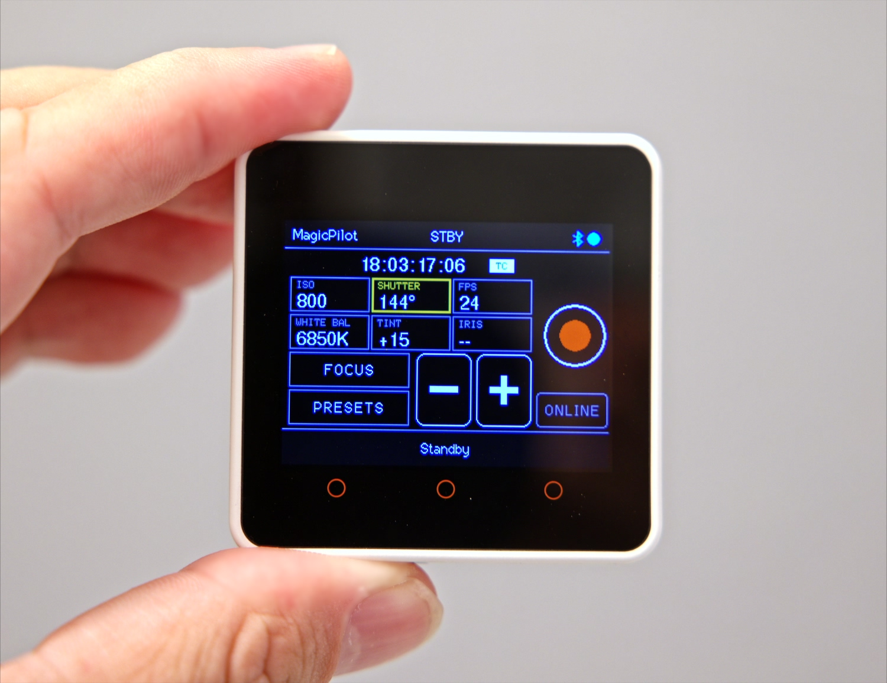
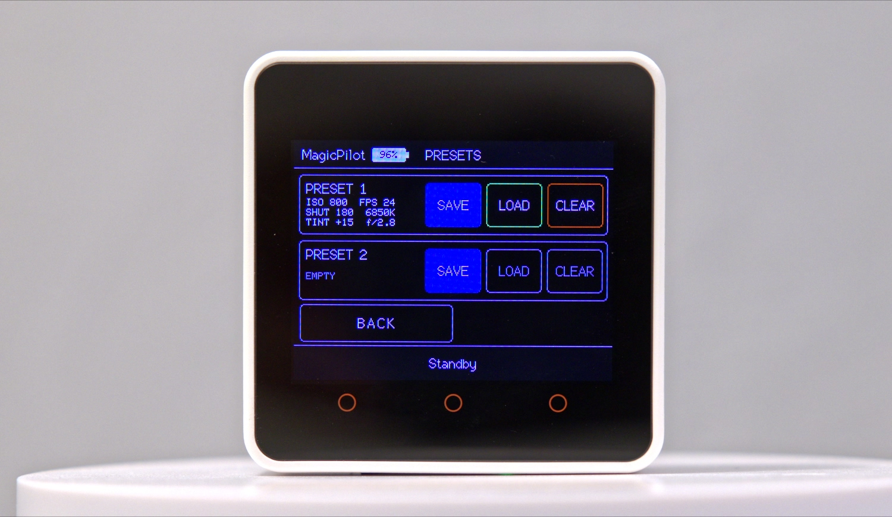

# ✨ MagicPilot Remote: Bluetooth Remote for the Blackmagic Pocket Cinema Camera 6K

### 🎬 A tiny open-source touchscreen remote for the BMPCC6K, built on ESP32 / M5Stack.

🌐 **Website:** [kenfilms.github.io/MagicPilot_Remote](https://kenfilms.github.io/MagicPilot_Remote/)

 






https://github.com/user-attachments/assets/88d4dcbc-c6db-4bb7-9184-9daaf6ef9eb5

[Watch the MagicPilot Remote demo video](docs/video/MagicPilot_Remote.mp4)

**MagicPilot Remote** is a free, open-source wireless remote control for Blackmagic cameras, tested with the **Blackmagic Pocket Cinema Camera 6K (BMPCC6K)**. The firmware runs on an ESP32-based **M5Stack Core2, CoreS3, or CoreS3-SE** touchscreen and talks to the camera directly over **Bluetooth Low Energy (BLE)** using the official **Blackmagic Camera Control** protocol. You can pull focus, trigger autofocus, change ISO, shutter angle, frame rate, white balance, tint and iris, start and stop recording, and save camera presets without a phone, a Wi-Fi network, or the Blackmagic Camera app.

## Table of contents

- [Overview](#overview)
  - [Why MagicPilot?](#why-magicpilot)
  - [Everything you need at a glance](#-everything-you-need-at-a-glance)
- [Getting started](#getting-started)
  - [Hardware](#-hardware)
  - [Build and flash](#build-and-flash)
    - [Arduino IDE](#arduino-ide)
    - [PlatformIO](#platformio)
  - [Camera compatibility](#-camera-compatibility)
- [Using the remote](#using-the-remote)
  - [Pairing](#pairing)
  - [Live readout and control](#live-readout-and-control)
  - [Focus](#focus)
  - [Presets](#presets)
  - [SD card](#sd-card)
- [FAQ](#faq)
- [Project layout](#project-layout)

## Overview

### Why MagicPilot?

**MagicPilot puts the controls you need on a tiny touchscreen that you can keep beside the camera.**

- **Next to your external monitor.** An external monitor is brighter than the camera's built-in screen, so that is where you look. MagicPilot mounts right beside it, so the settings are in your line of sight.
- **When the camera is out of reach.** With the camera against a wall or mounted very high, such as on a crane, the remote changes settings and starts or stops recording from wherever you stand.

### ✨ Everything You need at a Glance

| | Feature | What it does |
|---|---|---|
| 🔭 | **Focus Control** | **NEAR → FAR** slider, 1% steps and one-shot autofocus. |
| 📊 | **Live Camera Readout** | ISO, shutter angle, FPS, white balance, tint, iris, timecode, battery and card status. |
| 🎛️ | **Parameter Control** | Tap a value, then use − / + to change it on the camera. |
| 🎥 | **Record Control** | Start and stop recording with one button. |
| 💾 | **Camera Presets** | Save and recall two complete camera configurations. |
| ☀️ | **Automatic Brightness** | The CoreS3 adjusts its display backlight to ambient light; Core2 retains its default brightness. |


## Getting started

### 🧰 Hardware

MagicPilot is designed around a small amount of readily available hardware:

- **M5Stack Core2, CoreS3, or CoreS3-SE** — touchscreen remote and ESP32 platform
- **BMPCC6K** — with Bluetooth enabled
- **microSD card** — optional; required for preset storage.

That's it.

**No phone. No Wi-Fi network. No external computer.**

### Build and flash

#### Arduino IDE

> [!NOTE]
> The Arduino IDE does not autodetect the board. You must select the matching board yourself before uploading. Automatic detection is only available with PlatformIO via `scripts/upload_auto.py`.

1. Install the ESP32/M5Stack board support package and the **M5Unified** and **M5GFX** libraries.
   For CoreS3/CoreS3-SE, also install the **LTR5XX** ambient light sensor library: download [LTR5XX.zip](https://m5stack-doc.oss-cn-shenzhen.aliyuncs.com/1205/LTR5XX.zip) and add it via *Sketch → Include Library → Add .ZIP Library…*.
2. Open `MagicPilot_Remote.ino`. Keep the folder name `MagicPilot_Remote` and the `src` folder next to it, because the firmware is in `src/main.cpp`.
3. Select the **M5Stack Core2** board for Core2, or **M5Stack CoreS3** for CoreS3 and CoreS3-SE.
4. Select the serial port and click Upload.

#### PlatformIO

> [!NOTE]
> With PlatformIO, run `python3 scripts/upload_auto.py` to automatically detect the connected Core2 or CoreS3/CoreS3-SE and upload the matching firmware. Connect exactly one supported device. Regular `pio run` commands do not auto-detect the board; they use the selected environment.

Requires [PlatformIO](https://platformio.org/). Build or upload a specific board with its environment:

```sh
pio run -e m5stack-core2                         # build Core2
pio run -e m5stack-core2 -t upload               # upload to Core2
```
```sh
pio run -e m5stack-cores3                        # build CoreS3/CoreS3-SE
pio run -e m5stack-cores3 -t upload              # upload to CoreS3/CoreS3-SE
```
```sh
python3 scripts/upload_auto.py                   # detect board and upload
pio device monitor                               # serial log at 115200 baud
```

CoreS3-SE uses the same CoreS3 PlatformIO environment and is detected as a CoreS3-family device by the automatic uploader.

### 📷 Camera compatibility

| Camera | Status |
|---|---|
| Blackmagic Pocket Cinema Camera 6K | 🟢 Supported |
| Pocket Cinema Camera 6K G2 | 🟡 Not Tested |
| Pocket Cinema Camera 6K Pro | 🟡 Not Tested |
| Pocket Cinema Camera 4K | 🟡 Not Tested |

## Using the remote

### Pairing

1. On the camera, open the Bluetooth setup menu and switch on Bluetooth.

The button then reads ONLINE. The status bar at the bottom shows the connection state, and the Bluetooth icon in the header turns blue when connected.

### Live readout and control

The main screen shows the camera's settings as they change. To adjust one, tap its box (it gets an orange border), then use the - / + buttons.

| Parameter | Readout | Control with - / + |
| --- | --- | --- |
| ISO | Current value | ISO 100 – ISO 25,600 |
| Shutter | Angle | 11.2–360° |
| FPS | Frame rate | 5–120 fps |
| White balance | Kelvin | 2,500–10,000 K (50 K steps) |
| Tint | Signed value | −50 to +50 (1-step) |
| Iris | f-number | One lens stop per tap |
| Timecode | Timecode or clip counter | Tap to switch |
| Record | STBY / REC / PLAY | Record button |
| Camera battery | Voltage (tap header to show) | Read only; red below 6.8 V |
| Remote battery | Charge (tap header to show) | Read only; red below 15%, green while charging |
| Storage cards | Type, remaining time, active slot (tap footer to show) | Read only |

Iris changes can only reach lenses the camera can drive.

### Focus

Tap **FOCUS** on the main screen to open the focus page.

- **Slider**: drag from NEAR to FAR to set focus directly. The current position shows as a percentage.
- **- / +**: steps of exactly 1%, repeating while held. They work once the camera has reported its focus position; until then, move the slider once.
- **AF**: triggers the camera's one-shot autofocus.

Focus changes only reach lenses the camera can drive.

### Presets

Tap **PRESETS** on the main screen. The page has two slots, each with its own **SAVE**, **LOAD** and **CLEAR** button and a short summary of what it holds.

- **SAVE**: stores ISO, shutter, FPS, white balance, tint and iris as they are on the camera.
- **LOAD**: sends the stored values to the camera. The iris is stepped to the stored f-number.
- **CLEAR**: needs two taps to clear.
- **BACK**: returns to the main screen.

Presets live on the SD card, so they survive power-off.

### SD card

| Path | Content |
| --- | --- |
| `/presets/<date>_MagicPilot_Remote_Preset1.json`, `..._Preset2.json` | One JSON file per saved preset, for example `2026-10-05_MagicPilot_Remote_Preset1.json` |

Without a card the remote still works, but saving and loading presets shows "No SD card".

## FAQ

**How do I control a Blackmagic Pocket Cinema Camera 6K remotely without a phone?**
Flash MagicPilot onto an M5Stack Core2, CoreS3, or CoreS3-SE and switch on Bluetooth on the camera. The remote connects directly over Bluetooth LE, so you don't need a phone, tablet, Wi-Fi network, or the Blackmagic Camera app.

**Can MagicPilot pull focus on a BMPCC6K?**
Yes. The focus page has a NEAR → FAR slider, − / + buttons in 1% steps, and a one-shot autofocus (AF) button. It works with lenses the camera can drive electronically.

**Which Blackmagic cameras are supported?**
The Blackmagic Pocket Cinema Camera 6K is tested. Other cameras that implement the Blackmagic Camera Control Bluetooth protocol, such as the BMPCC 6K G2, 6K Pro and 4K, may work but haven't been tested yet. See [Camera compatibility](#-camera-compatibility).

**What hardware do I need?**
An M5Stack Core2, CoreS3, or CoreS3-SE (ESP32 touchscreen modules) and optionally a microSD card for presets. See [Hardware](#-hardware).

**Is MagicPilot free?**
Yes. It is open-source firmware licensed under the [LGPL-3.0](LICENSE).


## Project layout

- `src/main.cpp`: the whole firmware (BLE client, camera protocol, UI).
- `platformio.ini`: board, framework and library settings.

## Disclaimer

⚠️ Use at your own risk. MagicPilot is provided "as is" without warranty. The developer is not responsible or liable for damage, malfunction, loss of footage, data loss, or any other loss or damage to cameras, lenses, recording media, accessories, equipment, or property resulting from the use of this software or firmware. Always verify settings, compatibility, and operation before using MagicPilot with valuable or professional equipment.

MagicPilot is an independent open-source project and is not affiliated with, endorsed by, or sponsored by Blackmagic Design Pty. Ltd.
Blackmagic Design, Blackmagic Pocket Cinema Camera, BMPCC, and related names and trademarks are the property of Blackmagic Design Pty. Ltd.
